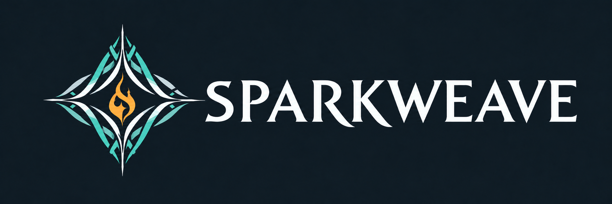

# Sparkweave Minimap

An independent community-maintained, client-side Enshrouded minimap fork. It draws in the game client through Shroudtopia; it is not an external overlay and has no server component.

## Current source candidate

`0.5.12-local-r1` contains the all-size GPU terrain path, incremental fog updates, marker/cache improvements, north-up default with explicit rotating mode, and CPU fallback. The sealed offline build and independent acceptance passed; see [the evidence and limits](docs/testing/minimap-gpu-all-sizes-2026-10-18.md). This candidate is not a GitHub release. Live gameplay, physical HDR display, and FPS/performance acceptance have not been established.

The latest published release remains [v0.5.7](https://github.com/Aerox912/Enshrouded-minimap/releases/tag/v0.5.7). This source update does not publish a binary release.

## Features

- Circular client minimap with world clock and local weather.
- Fog of war and original world locations, with navigation markers visible through fog.
- Player, ping, waypoint, altar, NPC, tombstone and quest markers where client data is available.
- North-up by default; optional rotating orientation.
- Seven widget sizes from 50% to 200%, independent terrain zoom, and configurable hotkeys.
- GPU terrain rendering across configured sizes, with a CPU fallback.

## Requirements and installation

Requires Windows x64 Enshrouded and a compatible Shroudtopia installation on each player's client. No server component is required. See [the v0.5.7 release asset](https://github.com/Aerox912/Enshrouded-minimap/releases/tag/v0.5.7) for the currently published package and its installation notes. Do not treat this unreleased source candidate as an installable release.

## Build and test

Run `ci/build.ps1` from a Visual Studio 2022 x64 Native Tools PowerShell prompt. It builds the mod and fixture-free native suites, then creates a local package. Packaging requires a clean commit and a new output directory. See [test instructions](tests/README.md) and [the candidate evidence](docs/testing/minimap-gpu-all-sizes-2026-10-18.md).

## Credits and licensing

This fork is based on elxokker's [Enshrouded Minimap](https://github.com/elxokker/Enshrouded-minimap), with required Shroudtopia integration by s0T7x / Miguel Oppermann. See [CREDITS.md](CREDITS.md) for upstream notices and asset provenance. The included 2048×2048 Embervale map is owned by Nick and authorized by its owner for inclusion in this repository; it is excluded from the repository MIT license. Other third-party game artwork and trademarks remain with their respective owners.
